# Шаблоны проектирования GoF
Шаблоны проектирования (Design Patterns) по классификации GoF (Gang of Four) делятся на три большие группы:

- Порождающие (Creational) — отвечают за удобное и гибкое создание объектов.
- Структурные (Structural) — описывают способы компоновки объектов и классов для получения более крупных структур.
- Поведенческие (Behavioral) — описывают алгоритмы взаимодействия объектов, распределение обязанностей, коммуникацию и так далее.

Применим следующие шаблоны:

- Порождающие шаблоны (3 шт.)
    - Factory Method
    - Singleton
    - Builder

- Структурные шаблоны (4 шт.)
    - Facade
    - Adapter
    - Decorator
    - Proxy

- Поведенческие шаблоны (5 шт.)
    - Strategy
    - Observer
    - Command
    - Template Method
    - Chain of Responsibility


## 1. Порождающие шаблоны

    1. Factory Method

        Назначение   
        Предоставляет интерфейс для создания объектов, но позволяет подклассам решать, какой именно объект будет создан.

        Пример использования в проекте: У нас может быть фабрика для создания различных типов анализаторов видео (к примеру, для разных социальных сетей или разных алгоритмов обработки).

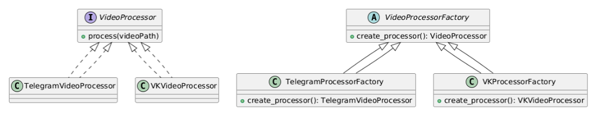 

```
class VideoProcessor:
    """ Базовый класс для процессора видео. """
    def process(self, video_path):
        raise NotImplementedError

class TelegramVideoProcessor(VideoProcessor):
    def process(self, video_path):
        print("Analyzing Telegram video")
        # ... специфическая логика обработки

class VKVideoProcessor(VideoProcessor):
    def process(self, video_path):
        print("Analyzing VK video")
        # ... специфическая логика обработки

class VideoProcessorFactory:
    """ Creator """
    def create_processor(self) -> VideoProcessor:
        """ Фабричный метод """
        raise NotImplementedError

class TelegramProcessorFactory(VideoProcessorFactory):
    """ Concrete Creator """
    def create_processor(self) -> VideoProcessor:
        return TelegramVideoProcessor()

class VKProcessorFactory(VideoProcessorFactory):
    """ Concrete Creator """
    def create_processor(self) -> VideoProcessor:
        return VKVideoProcessor()

# Пример использования
factory = TelegramProcessorFactory()  
processor = factory.create_processor()
processor.process("video.mp4")

```

    2. Singleton 
    
        Назначение   
        Гарантирует, что класс имеет только один экземпляр, и предоставляет глобальную точку доступа к нему.

        Пример использования в проекте: Мы хотим иметь единственный объект для подключения к базе данных или для хранения конфигураций приложения.

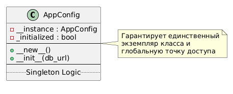

```
class AppConfig:
    __instance = None

    def __new__(cls, *args, **kwargs):
        if cls.__instance is None:
            cls.__instance = super().__new__(cls)
            cls.__instance._initialized = False
        return cls.__instance

    def __init__(self, db_url=None):
        if not self._initialized:
            self.db_url = db_url or "localhost:5432"
            self._initialized = True

# Пример использования
config1 = AppConfig(db_url="db.prod.example.com")
config2 = AppConfig()

assert config1 is config2  # True
print(config1.db_url)      # db.prod.example.com
```

    3. Builder

        Назначение   
        Отделяет конструирование сложного объекта от его представления таким образом, что в результате одного и того же процесса конструирования могут получаться разные представления.

        Пример использования в проекте: Построение сложного запроса к поисковому сервису, где у нас есть разные поля (фильтрация по объектам, по времени, по платформе и т.д.).

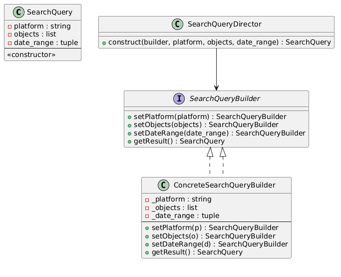

```
class SearchQuery:
    def __init__(self, platform="", objects=None, date_range=None):
        self.platform = platform
        self.objects = objects if objects else []
        self.date_range = date_range

class SearchQueryBuilder:
    def __init__(self):
        self._platform = ""
        self._objects = []
        self._date_range = None

    def setPlatform(self, platform):
        self._platform = platform
        return self

    def setObjects(self, objects):
        self._objects = objects
        return self

    def setDateRange(self, date_range):
        self._date_range = date_range
        return self

    def getResult(self):
        return SearchQuery(self._platform, self._objects, self._date_range)

class SearchQueryDirector:
    def construct(self, builder: SearchQueryBuilder, platform, objects, date_range):
        return (builder
                .setPlatform(platform)
                .setObjects(objects)
                .setDateRange(date_range)
                .getResult())

# Пример использования
builder = SearchQueryBuilder()
director = SearchQueryDirector()
query = director.construct(builder, 
                           platform="Telegram", 
                           objects=["car", "tree"],
                           date_range=("2023-01-01","2023-02-01"))
print(query.platform, query.objects, query.date_range)
```

2. Структурные шаблоны

    1. Facade

        Назначение    
        Предоставляет унифицированный интерфейс к набору интерфейсов в подсистеме, облегчая использование системы.

        Пример использования в проекте: Фасад для взаимодействия с несколькими сервисами распознавания/поиска.

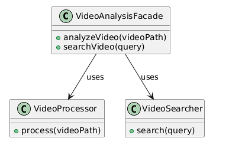

```
class VideoAnalysisFacade:
    def __init__(self, processor, searcher):
        self.processor = processor
        self.searcher = searcher

    def analyzeVideo(self, video_path):
        return self.processor.process(video_path)

    def searchVideo(self, query):
        return self.searcher.search(query)

# Пример использования
processor = TelegramVideoProcessor()
searcher = VideoSearcher()  # условный класс
facade = VideoAnalysisFacade(processor, searcher)

results = facade.analyzeVideo("video.mp4")
filtered = facade.searchVideo({"objects": ["car"]})
```

    2. Adapter

        Назначение    
        Преобразует интерфейс одного класса к другому интерфейсу, который ожидают клиенты.

        Пример использования в проекте: Адаптер для интеграции с разными API социальных сетей, чтобы выровнять их методы под единый интерфейс.

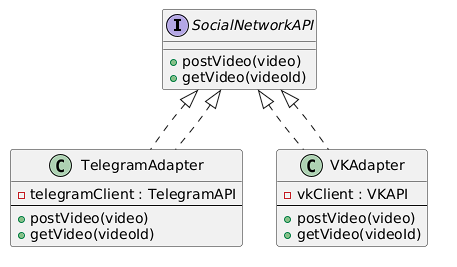

```
class SocialNetworkAPI:
    def postVideo(self, video):
        raise NotImplementedError
    def getVideo(self, video_id):
        raise NotImplementedError

class TelegramAdapter(SocialNetworkAPI):
    def __init__(self, telegram_client):
        self.telegram_client = telegram_client

    def postVideo(self, video):
        # Преобразуем данные и вызываем telegram_client.send_message()
        self.telegram_client.send_video(video)

    def getVideo(self, video_id):
        return self.telegram_client.fetch_video(video_id)

class VKAdapter(SocialNetworkAPI):
    def __init__(self, vk_client):
        self.vk_client = vk_client

    def postVideo(self, video):
        self.vk_client.uploadVideo(video)

    def getVideo(self, video_id):
        return self.vk_client.getVideoById(video_id)
```       

    3. Decorator

        Назначение       
        Динамически наделяет объект новыми возможностями. Является гибкой альтернативой наследованию при расширении функциональности.

        Пример использования в проекте: Добавление дополнительных шагов анализа (например, фильтрация кадров или сжатие) к основному объекту VideoProcessor.

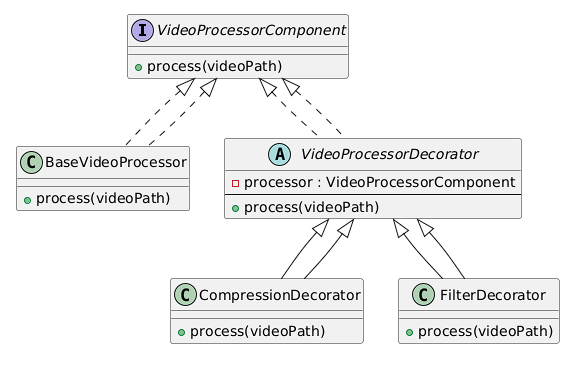

```
class BaseVideoProcessor:
    def process(self, video_path):
        print("Base processing of video")

class VideoProcessorDecorator(BaseVideoProcessor):
    def __init__(self, processor):
        self.processor = processor

    def process(self, video_path):
        self.processor.process(video_path)

class CompressionDecorator(VideoProcessorDecorator):
    def process(self, video_path):
        print("Compressing video before processing")
        super().process(video_path)

class FilterDecorator(VideoProcessorDecorator):
    def process(self, video_path):
        print("Applying filter before processing")
        super().process(video_path)

# Пример использования
processor = BaseVideoProcessor()
processor_with_compression = CompressionDecorator(processor)
processor_with_filter_and_compression = FilterDecorator(processor_with_compression)

processor_with_filter_and_compression.process("video.mp4")
```

    4. Proxy

    Назначение     
    Предоставляет суррогат или заменитель другого объекта для контроля доступа к нему.

    Пример использования в проекте: Кэширующий прокси для результатов анализа видео. Если видео уже анализировалось, можно вернуть результат из кэша.

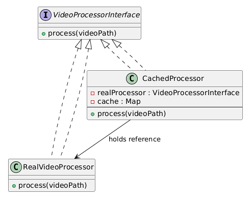

```
class VideoProcessorInterface:
    def process(self, video_path):
        raise NotImplementedError

class RealVideoProcessor(VideoProcessorInterface):
    def process(self, video_path):
        print("Real analysis logic")
        return {"objects": ["car", "tree"]}

class CachedProcessor(VideoProcessorInterface):
    def __init__(self, real_processor):
        self.real_processor = real_processor
        self.cache = {}

    def process(self, video_path):
        if video_path in self.cache:
            print("Returning cached result")
            return self.cache[video_path]
        result = self.real_processor.process(video_path)
        self.cache[video_path] = result
        return result

# Пример использования
processor = CachedProcessor(RealVideoProcessor())
res1 = processor.process("video.mp4")  # Анализ
res2 = processor.process("video.mp4")  # Кэш
```

3. Поведенческие шаблоны

    1. Strategy

        Назначение    
        Определяет семейство алгоритмов, инкапсулирует каждый из них и обеспечивает их взаимозаменяемость.

        Пример использования: Разные алгоритмы поиска (по ключевым словам, по типам объектов, по временным меткам).

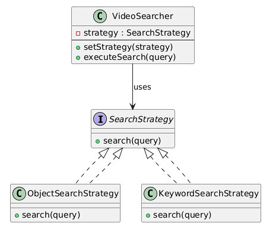

```
class SearchStrategy:
    def search(self, query):
        raise NotImplementedError

class ObjectSearchStrategy(SearchStrategy):
    def search(self, query):
        print(f"Searching by objects: {query.get('objects', [])}")
        return ["video1", "video2"]

class KeywordSearchStrategy(SearchStrategy):
    def search(self, query):
        print(f"Searching by keywords: {query.get('keywords', [])}")
        return ["video3", "video4"]

class VideoSearcher:
    def __init__(self, strategy: SearchStrategy):
        self.strategy = strategy

    def setStrategy(self, strategy: SearchStrategy):
        self.strategy = strategy

    def executeSearch(self, query):
        return self.strategy.search(query)

# Пример использования
searcher = VideoSearcher(ObjectSearchStrategy())
result1 = searcher.executeSearch({"objects": ["car"]})

searcher.setStrategy(KeywordSearchStrategy())
result2 = searcher.executeSearch({"keywords": ["holiday"]})
```

    2. Observer

        Назначение   
        Определяет зависимость «один ко многим» между объектами таким образом, что при изменении состояния одного объекта все зависящие от него оповещаются и обновляются автоматически.

        Пример использования: Уведомление всех заинтересованных клиентов (или UI-элементов) при завершении анализа видео.

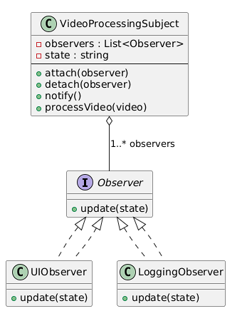

```
class VideoProcessingSubject:
    def __init__(self):
        self._observers = []
        self._state = None

    def attach(self, observer):
        self._observers.append(observer)

    def detach(self, observer):
        self._observers.remove(observer)

    def notify(self):
        for observer in self._observers:
            observer.update(self._state)

    def processVideo(self, video):
        print("Processing video...")
        self._state = "COMPLETED"
        self.notify()

class Observer:
    def update(self, state):
        raise NotImplementedError

class UIObserver(Observer):
    def update(self, state):
        print(f"UI updated with state: {state}")

class LoggingObserver(Observer):
    def update(self, state):
        print(f"Logging analysis state: {state}")

# Пример использования
subject = VideoProcessingSubject()
ui_observer = UIObserver()
log_observer = LoggingObserver()

subject.attach(ui_observer)
subject.attach(log_observer)

subject.processVideo("video.mp4")
```

    3. Command

        Назначение   
        Инкапсулирует запрос как объект, позволяя задавать параметры для обработки запроса, ставить запросы в очередь или логировать их, а также поддерживать операции отмены.

        Пример использования: Выполнение различных команд по анализу или поиску, которые можно ставить в очередь.

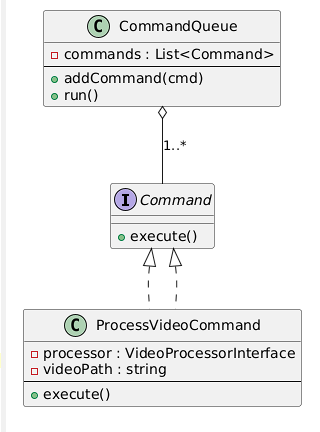

```
class Command:
    def execute(self):
        raise NotImplementedError

class ProcessVideoCommand(Command):
    def __init__(self, processor, video_path):
        self.processor = processor
        self.video_path = video_path

    def execute(self):
        self.processor.process(self.video_path)

class CommandQueue:
    def __init__(self):
        self._commands = []

    def addCommand(self, command: Command):
        self._commands.append(command)

    def run(self):
        for cmd in self._commands:
            cmd.execute()
        self._commands.clear()

# Пример использования
processor = RealVideoProcessor()
queue = CommandQueue()
queue.addCommand(ProcessVideoCommand(processor, "video1.mp4"))
queue.addCommand(ProcessVideoCommand(processor, "video2.mp4"))
queue.run()
```

    4. Template Method

        Назначение     
        Определяет скелет алгоритма в методе, перекладывая ответственность за некоторые его шаги на подклассы.

        Пример использования: Общий шаблон обработки видео, где конкретные шаги (например, извлечение кадров, распознавание объектов) определяются в подклассах.

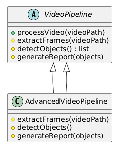

```
class VideoPipeline:
    def processVideo(self, video_path):
        self.extractFrames(video_path)
        objects = self.detectObjects()
        self.generateReport(objects)

    def extractFrames(self, video_path):
        raise NotImplementedError

    def detectObjects(self):
        raise NotImplementedError

    def generateReport(self, objects):
        raise NotImplementedError

class AdvancedVideoPipeline(VideoPipeline):
    def extractFrames(self, video_path):
        print("Extracting frames from advanced pipeline")

    def detectObjects(self):
        print("Detecting objects with advanced pipeline")
        return ["car", "person"]

    def generateReport(self, objects):
        print(f"Generating advanced report: found {objects}")

# Пример использования
pipeline = AdvancedVideoPipeline()
pipeline.processVideo("video.mp4")
```

    5. Chain of Responsibility

        Назначение    
        Позволяет избежать жесткой привязки отправителя запроса к его получателю, передавая запрос по цепочке потенциальных получателей.

        Пример использования: Разные этапы валидации/обработки видео (проверка формата, проверка размера, проверка наличия метаданных), которые идут последовательно.

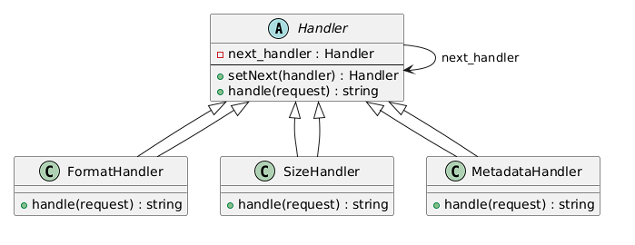

```
class Handler:
    def __init__(self):
        self._next_handler = None

    def setNext(self, handler):
        self._next_handler = handler
        return handler

    def handle(self, request):
        if self._next_handler:
            return self._next_handler.handle(request)
        return None

class FormatHandler(Handler):
    def handle(self, request):
        if not request.endswith(".mp4"):
            return "Invalid Format"
        return super().handle(request)

class SizeHandler(Handler):
    def handle(self, request):
        # Допустим, проверяем размер файла
        file_size = 500  # условно
        if file_size > 1000:
            return "File is too large"
        return super().handle(request)

class MetadataHandler(Handler):
    def handle(self, request):
        # Проверяем наличие метаданных
        has_metadata = True
        if not has_metadata:
            return "No metadata found"
        return super().handle(request)

# Пример использования
h1 = FormatHandler()
h2 = SizeHandler()
h3 = MetadataHandler()

h1.setNext(h2).setNext(h3)

result = h1.handle("test_video.mp4")
if result:
    print("Chain result:", result)
else:
    print("Video is valid!")
```

# Шаблоны проектирования GRASP

Шаблоны (или принципы) GRASP фокусируются на распределении обязанностей между объектами и классами, а также на организации взаимодействия. Мы рассмотрим 5 ролей (обязанностей) классов, 3 принципа разработки и 1 свойство программы.

## Роли (обязанности) классов (5 ролей)

### Creator
- **Проблема**: Необходимо определить, какой класс отвечает за создание экземпляров других классов.  
- **Решение**: Класс, который использует или содержит создаваемые объекты, должен их создавать.  
- **Пример**: В нашем проекте фабричный метод (Factory Method) в `VideoProcessorFactory` создаёт объекты конкретных процессоров.  
- **Результат**: Централизованное создание объектов, упрощённая структура кода.  
- **Связь с другими паттернами**: Factory Method (GoF), Abstract Factory  

### Information Expert
- **Проблема**: Кто должен быть ответственным за вычисление (или хранение) конкретной информации?  
- **Решение**: Экспертом является тот класс, который владеет соответствующими данными.  
- **Пример**: Класс `SearchQuery` хранит информацию о платформе, объектах и датах, и отвечает за работу с этими данными.  
- **Результат**: Минимизация дублирования и более осмысленное распределение обязанностей.  
- **Связь**: KISS, DRY  

### Controller
- **Проблема**: Кто обрабатывает входные запросы и управляет остальными объектами приложения?  
- **Решение**: Специальный класс-контроллер (или фасад) берёт на себя координацию.  
- **Пример**: `VideoAnalysisFacade` выступает как Controller, получая запросы на анализ и поиск, и делегируя задачу конкретным сервисам.  
- **Результат**: Разделение бизнес-логики и логики представления, снижение сцепления.  
- **Связь**: Facade, MVC  

### Low Coupling
- **Проблема**: Избежать сильной зависимости между классами.  
- **Решение**: Каждый класс взаимодействует только с ограниченным набором других классов.  
- **Пример**: `VideoProcessor` не знает детали работы `SocialNetworkAPI`, обращается через интерфейс или адаптер.  
- **Результат**: Упрощённое сопровождение кода, более гибкая архитектура.  
- **Связь**: Adapter, DIP (SOLID)  

### High Cohesion
- **Проблема**: Сделать классы максимально сфокусированными на одной задаче.  
- **Решение**: Каждая сущность имеет чётко определённую роль и отвечает за узкий набор функций.  
- **Пример**: Класс `TelegramAdapter` только адаптирует логику к Telegram, без поиска или анализа видео.  
- **Результат**: Легче модифицировать, тестировать и повторно использовать код.  
- **Связь**: Single Responsibility Principle (SOLID), KISS  

---

## Принципы разработки (3 принципа)

### Single Responsibility Principle (SRP)
- **Проблема**: Когда класс отвечает за слишком много задач, код становится сложным.  
- **Решение**: У каждого класса должна быть одна ответственность.  
- **Пример**: `SearchQueryBuilder` занимается только построением запроса, не анализирует видео и не сохраняет результаты.  
- **Результат**: Код проще расширять и поддерживать.  
- **Связь**: High Cohesion (GRASP)  

### Open/Closed Principle (OCP)
- **Проблема**: При добавлении нового функционала нежелательно переписывать существующий код.  
- **Решение**: Классы и модули должны быть открыты для расширения, но закрыты для модификации.  
- **Пример**: Шаблон Strategy — можно добавить новую стратегию поиска, не меняя существующие стратегии.  
- **Результат**: Код становится гибким и легко расширяемым.  
- **Связь**: Strategy, Factory Method  

### Dependency Inversion Principle (DIP)
- **Проблема**: Жесткие зависимости на конкретные классы затрудняют масштабирование и тестирование.  
- **Решение**: Модули верхнего уровня не должны зависеть от модулей нижнего уровня; оба должны зависеть от абстракций.  
- **Пример**: `VideoSearcher` использует абстрактный интерфейс `SearchStrategy` вместо конкретных реализаций.  
- **Результат**: Упрощённое тестирование (можно подменять реализацию), гибкая конфигурация.  
- **Связь**: Adapter, Strategy  

---

## Свойство программы (цель)

### Пример: Расширяемость (Extensibility)
- **Проблема**: Система должна легко адаптироваться к новым требованиям или функционалу.  
- **Решение**: Использовать паттерны, позволяющие добавлять новые компоненты (стратегии, декораторы, фабрики) без изменения существующего кода.  
- **Пример**: При добавлении нового алгоритма распознавания не меняем старый код, а просто создаём новую конкретную фабрику/класс.  
- **Результат**: Легко адаптировать систему к изменяющимся требованиям.  
- **Связь**: Strategy (добавление новой стратегии), Decorator (добавление нового декоратора), Factory Method (новые фабрики) 